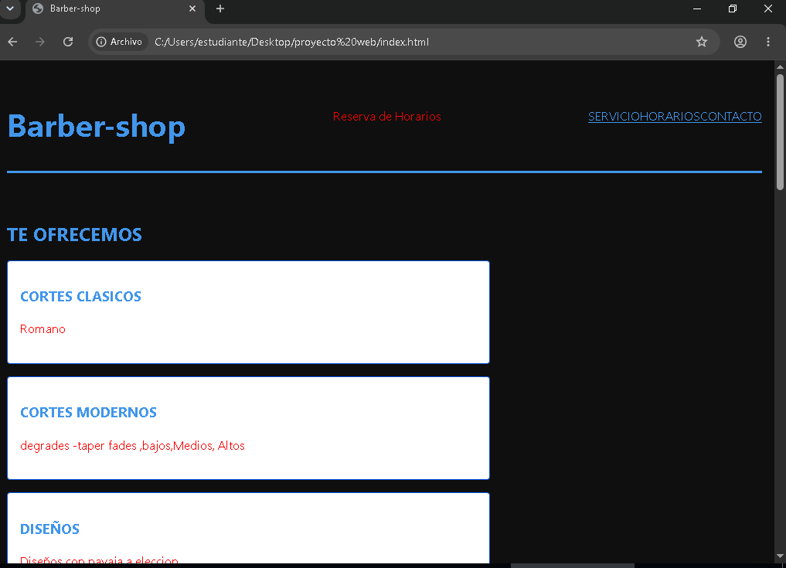

# [Nombre del proyecto]

**Estudiante:** [Eduardo Patty Churqui]
**Cliente:** [barber-shop]
**URL publicada:** [DESPUES, PROXIMA SEMANA]

## Qué resuelve
[2-3 frases: 

1-tiene problemas de agendamiento de citas de los clientes 

2-necesita que mediante la pagina web puedan registrarse y marcar la hora en que vendran

3-la pagina contara con la ubicasion del local y tambien podran realizarse los pagos mediante un QR añdismos e la misma ]

## Cómo está construido
- **Semántica:** 
1.[header: en la parte superior de la página. Contiene  la marca y la barra de navegación principal.

2.main: El contenedor central que envuelve todo el contenido único y relevante de la vista actual.

3.section: lo use para dividir el contenido en bloques  ).

4.article: Usado para bloques de contenido(por ejemplo la pagina tendra 3 secciones en las cuales el cliente o usuario podra ingresar 1.cortes modernos 2.cortes clasicos 3.diseños con navaja
en los cuales una vez ingresado podra elegir entre todo un catalogo).

5.aside: Para poner un mensaje o un enlace en mi caso solo puse una pregunta y respuesta de la pagina.

6.footer: Ubicado al final contiene la información de contacto, enlaces y tambien aviso de privacidad

7.div: lo use para agrupar otros elementos :como textos, imágenes, botones]

- **Layout:** [dónde Flexbox fue para alinear o mover los bloques o imagenes al centro o al costado alineacion de la pagina para verse mas ordenada, 

dónde Grid, 
me permitio  organizar elementos en filas y columnas al mismo tiempo,]

- **Diseño:**
[paleta y tipografía, 
para que combine con el negocio del cliente .. como sera una barberia los colores que mayor mente se usan son rojo,azul o blanco y negro ]

## Capturas

 DESPUES, PROXIMA SEMANA

## Lo más difícil
[Qué problema técnico te costó más y cómo lo resolviste. 

Sé específico:  problema mayor que tuve fue el de organizar las tablas con el FLEXBOX opte por matener el diseño original por ahora de que este al lado izquierdo ]